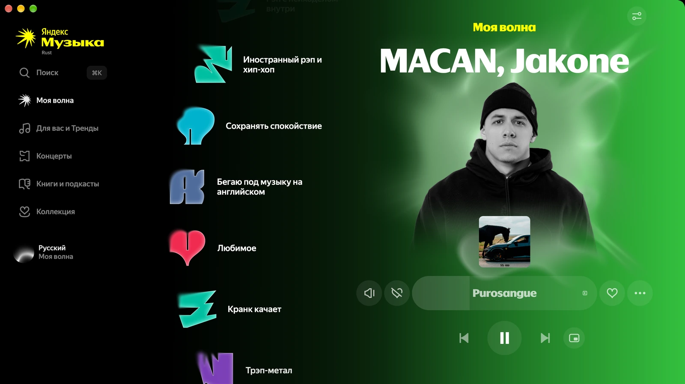
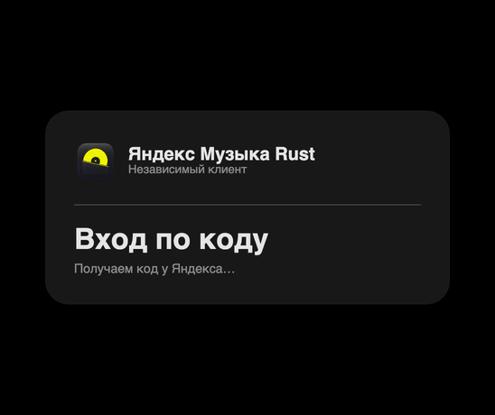
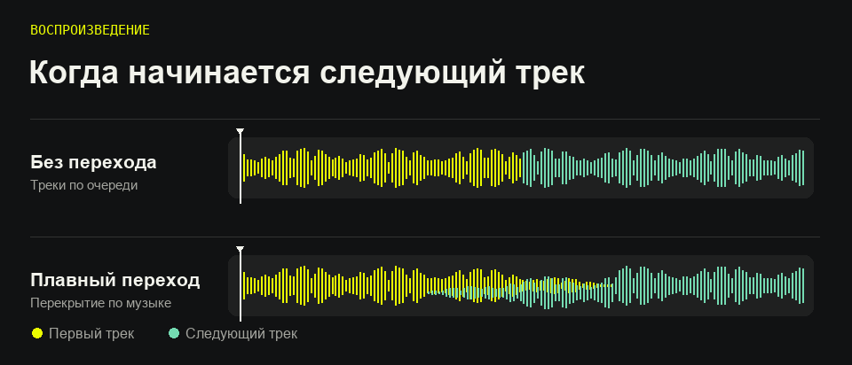

<div align="center">


# Яндекс Музыка Rust

Независимый плеер для Mac с Apple Silicon. «Моя волна» с вашими фильтрами, сведение треков в бит и мини-плеер поверх окон.

**[Скачать DMG для Mac](https://github.com/rnqg/yandex-music-rust/releases/latest/download/music-rust-macos-arm64.dmg)**　·　[Что нового в 1.2.0](https://github.com/rnqg/yandex-music-rust/releases/tag/v1.2.0)　·　[Поддержка](https://t.me/dozhr)



</div>

## Установка

1. Скачайте DMG, откройте его и перетащите **Яндекс Музыка Rust** в **Программы**.
2. Запустите плеер. На экране входа выберите **Открыть ya.ru/device** и введите код в браузере. После подтверждения плеер сам откроет ваш аккаунт.

Нужны macOS 13 или новее, чип Apple Silicon и интернет. Для полных треков нужен Яндекс Плюс. У сборки локальная подпись. Если Gatekeeper заблокирует первый запуск, проверьте источник загрузки и контрольную сумму в релизе. Для этой сборки доступно разрешение в **Системные настройки → Конфиденциальность и безопасность**.

<details>
<summary>Посмотреть экран входа</summary>



</details>

## Что умеет версия 1.2.0

### Сведение и эквалайзер

Включите **Настройки → Воспроизведение → Плавный переход** и выберите предел в **3, 6, 9 или 12 секунд**. Плеер анализирует конец текущего трека и начало следующего. При близком ритме он совмещает удары и постепенно передаёт бас следующему треку. При большой разнице в темпе сокращает наложение. На выбор стыка также влияют гармония, плотность звука и запас по громкости. Часть тихого вступления может быть пропущена.

По умолчанию кроссфейд выключен. При последовательном прослушивании соседних треков альбома плеер сохраняет авторский стык.



**Параметрический эквалайзер** даёт отдельно настроить усиление, центральную частоту и ширину каждой из десяти полос. Так можно приглушить узкий резонанс наушников или сделать бас мягче.

### Рекомендации и фильтры

| Настройка | Как работает |
| --- | --- |
| Без повторов в Моей волне | Один и тот же трек возвращается в автоматическую подборку не раньше чем через 24 часа. История привязана к аккаунту и сохраняется после перезапуска. |
| Фильтры версий | Ремиксы, концертные записи и версии с изменённой скоростью можно пропускать независимо друг от друга. Выбранный вручную трек можно включить. |
| Блокировка исполнителей | Скрывает исполнителя из автоматического воспроизведения. Отдельная настройка распространяет правило на совместные треки. |
| Меньше ИИ | Просит сервис реже рекомендовать музыку, созданную с помощью ИИ. |
| Очередь | Можно остановить воспроизведение в конце альбома или плейлиста либо поставить найденный трек следующим. |
| Реклама и промо | Клиент скрывает распознанные рекламные карточки и пропускает аудиовставки с рекламной меткой, в том числе между треками. Рекламу внутри самой записи фильтр не распознаёт. |
| Лента | Ненужные блоки можно скрывать, затем вернуть в настройках. |

### Управление на Mac

- **Мини-плеер** открывается из плеера и из «Моей волны». Компактное окно остаётся поверх других приложений. Можно переключать треки и возвращаться в основное окно с анимацией.
- **Быстрые действия** открываются по **⌘K**. Можно сразу включить волну, открыть коллекцию или найти трек, плейлист и артиста. **Enter** запускает выбранный трек, **⌥ Enter** ставит его следующим.
- **ProMotion до 120 Гц** на совместимом экране. В режиме «Плавный» интерфейс синхронизирует перерисовку с дисплеем, а фон «Моей волны» рисуется через Metal. Частоту выбирает macOS. Для экономии ресурсов есть режим «Лёгкий».
- **Discord Rich Presence** показывает трек, исполнителя, обложку и прогресс. Из статуса можно открыть трек и репозиторий проекта. Также работают медиаклавиши и Пункт управления macOS.
- **Вход по коду** запоминается для вашей учётной записи Mac. Плеер хранит сеанс в файле с доступом для владельца и не обращается к Связке ключей за токеном. При переходе с версии, хранившей вход в Связке ключей, потребуется один новый вход.

### Коллекция и тексты

Поиск, коллекция, история, чарты, плейлисты, альбомы, страницы артистов, концерты, книги и подкасты доступны в основном окне. Для скачивания можно выбрать папку и предпочитаемый формат FLAC, если он доступен для трека.

В полноэкранном плеере обложка остаётся слева, а справа подсвечивается текущая строка синхронизированного текста.


## Размер на Mac


На одном Mac пакет **Яндекс Музыки Rust 1.2.0** занял **27,0 МБ**, а пакет **Яндекс Музыки 5.128.0** — **325,8 МБ**. DMG для загрузки весит **14,0 МБ**. Сложили размеры обычных файлов внутри каждого пакета `.app`, исключив символические ссылки. График показывает размер приложения без кэша и загруженной музыки. Единица измерения — 1 000 000 байт.

## Платформы

| Платформа | Статус |
| --- | --- |
| macOS 13+ · Apple Silicon | [Скачать стабильную версию](https://github.com/rnqg/yandex-music-rust/releases/latest) |
| Linux · Windows | В разработке |
| iOS · Android | В разработке |

<details>
<summary><strong>Сборка из исходников</strong></summary>

На Mac с Apple Silicon установите Rust stable (минимум 1.92), Xcode Command Line Tools и `dmgbuild==1.6.7`. Команды запускаются из корня репозитория.

```sh
cargo test --release --locked
bash tools/macos-dmg.sh "$HOME/Downloads/music-rust-macos-arm64.dmg"
```

Скрипту нужен свободный путь для нового DMG. Шрифты и элементы интерфейса клиент читает из установленной Яндекс Музыки или загружает из веб-версии.

</details>

Независимый некоммерческий проект. Яндекс Музыка и её товарные знаки принадлежат правообладателям. [Лицензия GPL-3.0](LICENSE) · [Уведомления об авторских правах](NOTICE) · [Сообщить об ошибке](https://github.com/rnqg/yandex-music-rust/issues) · [Поддержка @dozhr](https://t.me/dozhr)
