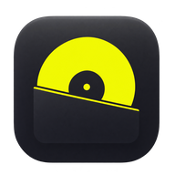
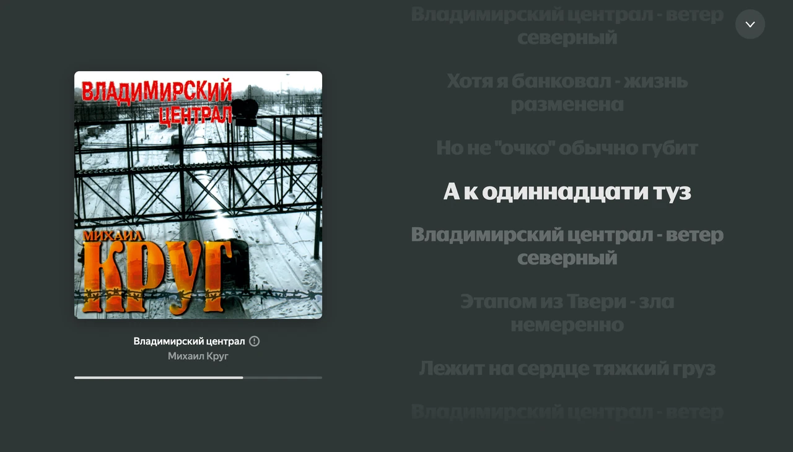
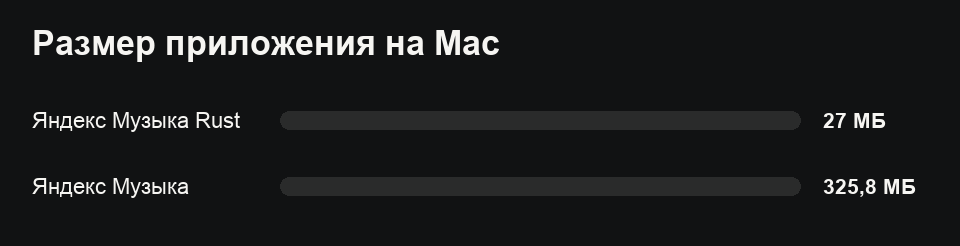

<div align="center">



# Яндекс Музыка Rust

Независимый плеер для Mac с Apple Silicon. «Моя волна» с вашими фильтрами, сведение треков в бит и мини-плеер поверх окон.

**[Скачать DMG для Mac](https://github.com/rnqg/yandex-music-rust/releases/latest/download/music-rust-macos-arm64.dmg)**　·　[Что нового в 1.2.0](https://github.com/rnqg/yandex-music-rust/releases/tag/v1.2.0)　·　[Поддержка](https://t.me/dozhr)


</div>

## Установка

Скачайте DMG, перетащите плеер в **Программы** и откройте его. При первом запуске подтвердите вход по коду на **ya.ru/device**. Аккаунт сохранится на этом Mac.

Поддерживаются Mac с Apple Silicon и macOS 13 или новее. Для полных треков нужен Яндекс Плюс. Если macOS заблокировала первый запуск из-за локальной подписи, сверьте контрольную сумму в релизе и разрешите запуск в **Системных настройках → Конфиденциальность и безопасность**.

<details>
<summary>Посмотреть экран входа</summary>


</details>

## Музыка

**Кроссфейд.** Плеер подбирает переход по темпу, гармонии и громкости двух треков. Если темп близкий, совмещает удары и постепенно передаёт бас следующему треку. Если темпы сильно различаются, сокращает переход. Соседние треки одного альбома сохраняют исходный стык. Кроссфейд по умолчанию выключен. В **Настройках → Воспроизведение → Плавный переход** можно выбрать 3, 6, 9 или 12 секунд.


**Эквалайзер.** У каждой из десяти полос регулируются частота, усиление и ширина.

**Моя волна.** Можно включить фильтр, чтобы один и тот же трек попадался не чаще раза в сутки. Отдельно отключаются ремиксы, концертные записи и версии с изменённой скоростью. Блокировка артиста по желанию распространяется на совместные треки. Для музыки, созданной с помощью ИИ, есть настройка «Меньше ИИ».

**Лента и реклама.** Ненужные блоки ленты можно скрыть. Плеер убирает рекламные карточки и пропускает помеченные рекламные вставки между треками.

## На Mac

- **Мини-плеер** остаётся поверх окон. Кнопка рядом с управлением воспроизведением позволяет развернуть его и вернуться обратно.
- **⌘K** открывает быстрые действия. Выберите трек и нажмите **Enter**, чтобы включить его, или **⌥ Enter**, чтобы поставить следующим. Здесь же можно открыть коллекцию или запустить волну.
- **ProMotion до 120 Гц** работает в режиме «Плавный» на совместимых дисплеях. Анимированный фон волны рисуется через Metal. Для работы от батареи есть режим «Лёгкий».
- **Discord** показывает обложку, трек, исполнителя и прогресс. Из статуса можно перейти к треку или открыть репозиторий. Плеером также можно управлять медиаклавишами и из Пункта управления macOS.
- **Коллекция** объединяет любимые треки, плейлисты и альбомы. Есть история прослушивания, чарты, концерты, книги и подкасты. Плеер может остановиться в конце альбома или плейлиста. Для скачивания доступны выбор папки и FLAC, если его предлагает сервис.

## Тексты песен

В полноэкранном плеере текущая строка подсвечивается в такт песне.



## Размер на Mac



Установщик весит **14 МБ**.

## Нагрузка на процессор

На Apple M5 оба плеера по очереди играли «Владимирский централ» Михаила Круга. Окна были перекрыты другим приложением. Цифры — средняя загрузка всех процессов плеера за 30 секунд, где 100 % соответствует одному ядру.

| Сценарий | Музыка Rust 1.2.0 | Яндекс Музыка 5.128.0 |
| --- | ---: | ---: |
| Коллекция, пауза | 0,8 % | 5,0 % |
| Коллекция, играет трек | 46,2 % | 48,3 % |
| Играет трек с открытым текстом | 51,3 % | 77,6 % |

## Другие платформы

Версии для Windows, Linux, iOS и Android в разработке.

<details>
<summary><strong>Сборка из исходников</strong></summary>

На Mac с Apple Silicon установите Rust stable (минимум 1.92), Xcode Command Line Tools и `dmgbuild==1.6.7`. Команды запускаются из корня репозитория.

```sh
cargo test --release --locked
bash tools/macos-dmg.sh "$HOME/Downloads/music-rust-macos-arm64.dmg"
```

Скрипту нужен свободный путь для нового DMG. Шрифты и элементы интерфейса клиент читает из установленной Яндекс Музыки или загружает из веб-версии.

</details>

Независимый некоммерческий проект. Яндекс Музыка и её товарные знаки принадлежат правообладателям. [Лицензия GPL-3.0](LICENSE) · [Уведомления об авторских правах](NOTICE) · [Сообщить об ошибке](https://github.com/rnqg/yandex-music-rust/issues) · [Поддержка @dozhr](https://t.me/dozhr)
